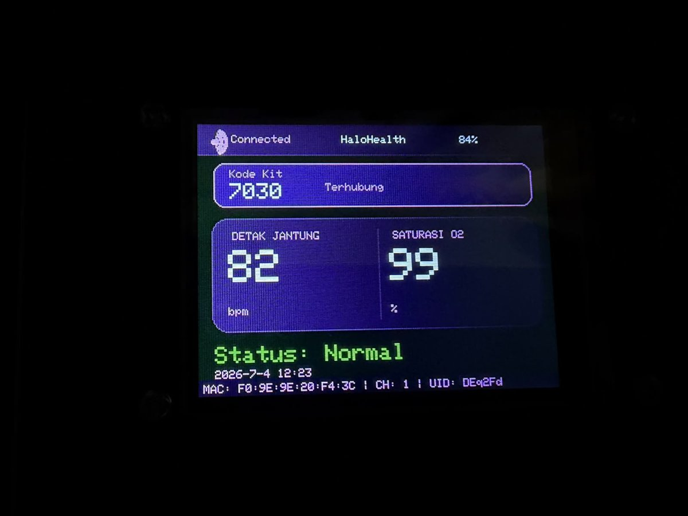
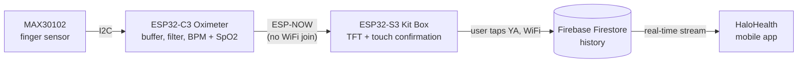
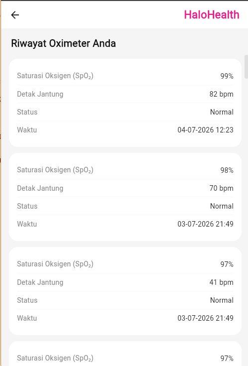
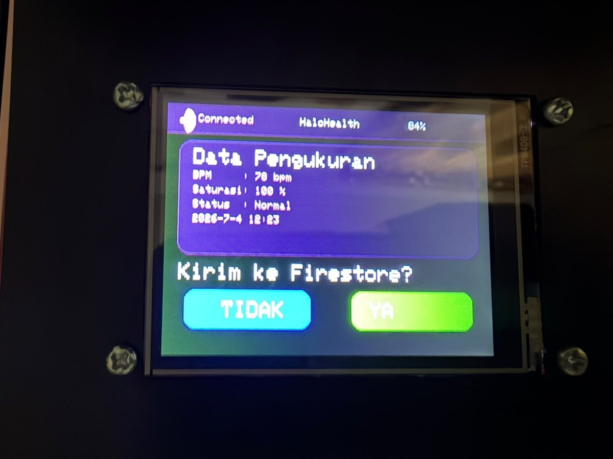

# HaloHealth

A home telemedicine kit box concept. This first stage fully implements the **pulse oximeter** (heart rate + SpO2): the measurement is shown on the kit box, the user confirms it on a touchscreen, and only then is it saved to a cloud history that the mobile app reads in real time.



> ⚠️ **Status: Prototype / course project.** Intended for personal, indicative monitoring only. It is **not a medical device**, has not been clinically validated, and must not be used for diagnosis. See [Known Limitations](#known-limitations): the current prototype showed an accuracy problem against a smartwatch.

## Overview
Existing telemedicine platforms mostly handle the consultation itself and do not keep a structured record of a patient's vital signs, so doctors cannot see trends. HaloHealth pairs a sensing unit with a cloud history, so every confirmed reading becomes part of a timestamped record that the patient (and eventually a doctor) can review.

At this stage only the oximeter is a real sensor. The other planned tools (blood pressure monitor, thermometer, general heart rate monitor) are shown with dummy data in the mobile app.

## How it works


1. The **oximeter unit** (ESP32-C3 + MAX30102) reads raw red/IR PPG samples, validates them (finger present, red/IR correlation, realistic BPM and SpO2 range), smooths them, and sends `{bpm, spo2, status}` to the kit box via ESP-NOW at most every 10 seconds.
2. The **kit box** (ESP32-S3 + 2.8" touchscreen) shows the result and asks **"Kirim ke Firestore?"** (send to Firestore?). Tapping *TIDAK* drops the reading; tapping *YA* hands it to a background FreeRTOS task on Core 0.
3. The reading is written to Firestore under the user who owns the kit, resolved through a random **Kit Code** that the user types in during app registration.
4. The **mobile app** listens to the same Firestore path and updates the history list instantly. (The app source is not part of this repository.)





## Features
- Heart rate and SpO2 from a MAX30102, computed on the ESP32-C3 (autocorrelation-based algorithm by R. Fraczkiewicz, with local tuning)
- Layered validation: finger threshold, red/IR correlation ≥ 0.78, BPM range check, SpO2 only accepted when BPM is accepted, median-of-3 + exponential smoothing
- Wireless relay with **ESP-NOW**, so the sensor unit never joins the WiFi network
- Two-gate data quality: automatic validation, then **manual confirmation** on the touchscreen
- Dual-core ESP32-S3 firmware: UI on Core 1, Firebase on Core 0 (semaphore + mutex), so the screen never freezes on a slow connection
- Chronological history in Firestore with NTP-synced timestamps
- Persistent Kit ID stored in EEPROM (hold the BOOT button for 3 s, or send `NEWID` over Serial, to generate a new one)
- Battery percentage on the kit box via a voltage divider on the ADC
- I2C watchdog on the oximeter that re-initializes the sensor if the bus hangs

## Repository Structure
```
halohealth/
├── oximeter-c3/            # ESP32-C3 firmware (PlatformIO): sensor, algorithm, ESP-NOW sender
│   ├── platformio.ini
│   └── src/                # main.cpp, max30102.*, algorithm_by_RF.*
├── kitbox-s3/              # ESP32-S3 firmware (PlatformIO): TFT UI, RTOS, Firestore, NTP
│   ├── platformio.ini
│   └── src/                # main.cpp, NTPTime.*, RandomID.*
├── firebase/
│   └── firestore.rules     # Recommended Firestore security rules
├── hardware/
│   ├── schematic/          # Oximeter and kit box schematics
│   └── bom.csv
├── docs/                   # architecture, wiring, setup, Firestore schema, security, test results
└── THIRD_PARTY_NOTICES.md
```
Each firmware folder is its own PlatformIO project, so open and flash them separately.

## Hardware
| Unit | Component | Purpose |
|------|-----------|---------|
| Oximeter | ESP32-C3 Super Mini | Sensing and ESP-NOW sender |
| Oximeter | MAX30102 | Red/IR PPG sensor (I2C) |
| Oximeter | Battery, JST-PH 2-pin connector | Power |
| Kit box | ESP32-S3 (DevKitC-1 class) | Display, relay receiver, cloud sync |
| Kit box | 2.8" ILI9341 TFT with touch | Output + YA/TIDAK input |
| Kit box | 3500 mAh Li-ion battery | Power |
| Kit box | TP4056 module | Battery charging with basic protection |
| Kit box | MT3608 boost converter | Stable supply for ESP32-S3 and TFT |
| Kit box | 2 x 1 kΩ resistors | Battery voltage divider for the ADC |

Full list: [`hardware/bom.csv`](hardware/bom.csv). Pinouts and notes: [`docs/wiring.md`](docs/wiring.md).

Schematics: [oximeter](hardware/schematic/oximeter-esp32c3.png) · [kit box](hardware/schematic/kitbox-esp32s3.png)

## Getting Started
Full guide: [`docs/setup.md`](docs/setup.md). In short:

1. **Firebase:** create a project with Firestore and Email/Password authentication, plus a dedicated account for the kit box, then publish the rules in [`firebase/firestore.rules`](firebase/firestore.rules). See [`docs/firestore-schema.md`](docs/firestore-schema.md) and [`docs/security.md`](docs/security.md).
2. **Kit box:** in `kitbox-s3/src/main.cpp`, replace the placeholders `NAMA WIFI`, `PASS WIFI`, `API KEY FIREBASE`, `ID PROJECT FIREBASE`, `ID-PROJECT-FIREBASE` (in the database URL), `EMAIL FIREBASE`, and `PASS FIREBASE` with your own values, then upload with PlatformIO. The TFT footer shows the board's MAC address and WiFi channel.
3. **Oximeter:** in `oximeter-c3/src/main.cpp`, set the kit box MAC address (`s3Address`) and the WiFi name (`WIFI_SSID`), then upload.
4. **Pair:** the kit box shows a 4-digit **Kode Kit** on its main screen. Enter it in the mobile app during registration.

```bash
cd kitbox-s3 && pio run -t upload     # kit box (ESP32-S3)
cd ../oximeter-c3 && pio run -t upload # oximeter (ESP32-C3)
```

## Test Results
| Test | Result |
|------|--------|
| Pipeline: sensor → ESP-NOW → TFT → confirmation → Firestore → app | Works end to end |
| BPM vs. a commercial smartwatch (7 readings) | Smartwatch 92-96 BPM, oximeter stayed at 99 BPM |

The static 99 reading was traced to a hardware problem (gap between the finger and the photodetector in the casing letting ambient light bypass the sensor). Details: [`docs/test-results.md`](docs/test-results.md).

## Known Limitations
- **Measurement accuracy is not yet reliable** (see above). Probe mechanics and signal isolation need rework before readings can be trusted.
- ESP-NOW only works if both boards are on the same WiFi channel; if the router changes channel, the link can fail silently until both devices restart.
- No real-time clock: timestamps depend on a successful NTP sync at boot.
- No offline queue: if the internet is down, the reading is shown but not stored.
- Finger presence is inferred from an IR threshold, so a loosely placed finger can reset the buffer mid-measurement.
- Kit pairing uses a typed Kit Code with no extra device authentication, and the kit box signs in to Firebase with one shared account (see [`docs/security.md`](docs/security.md)).
- Code notes: the `sudahKirim` flag in the oximeter is reset but never used; the confirmation buttons' hit-boxes and labels are cross-wired in the source (`BTN_YA_*` is drawn as TIDAK), which only behaves correctly if the touch X axis is mirrored, and no touch calibration is set; the `baterai` field from the schema is not written by the current firmware.

## Roadmap
- [x] MAX30102 measurement with validation and smoothing
- [x] ESP-NOW link between oximeter and kit box
- [x] Touchscreen confirmation before saving
- [x] Firestore history with NTP timestamps, shown in the mobile app
- [ ] Fix probe mechanics (finger-to-sensor contact, light shielding) and re-test accuracy
- [ ] Interrupt-driven FIFO reading using the MAX30102 INT pin, enabling sleep modes
- [ ] Offline queue and retry for failed writes
- [ ] Per-device authentication instead of a shared account
- [ ] Add a digital thermometer, then a blood pressure monitor
- [ ] Optionally merge both boards into a single ESP32-S3 to simplify the design

## Team
Final project for **CPEN6254010 IoT Design & Application** (class LA40), Computer Engineering, Binus University, even semester 2025/2026.

| Name | Contribution |
|------|--------------|
| Nathalie Arwan | PCB design, casing design, component selection, breadboard testing, PCB making, Firebase setup from the mobile side |
| Azalia Varsha Jeslyn Putri Legowo | MAX30102 configuration, PCB making |
| Julius Lim Khan ([@JuliusLK](https://github.com/JuliusLK)) | Firebase (Firestore) setup, TFT display, ESP32-S3 EEPROM, ESP-NOW configuration |

## Contributing
Pull requests are welcome. For major changes, please open an issue first.

## License
[MIT](LICENSE) for the project code. Third-party code keeps its own terms, see [`THIRD_PARTY_NOTICES.md`](THIRD_PARTY_NOTICES.md).

## Disclaimer
HaloHealth is an educational prototype. It does not replace a clinically calibrated pulse oximeter or professional medical advice.
