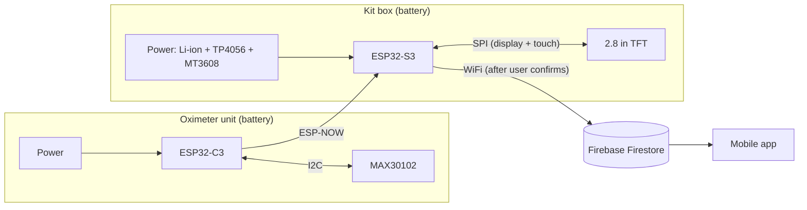
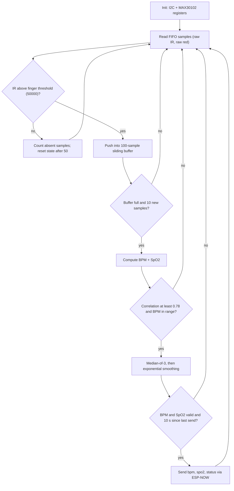
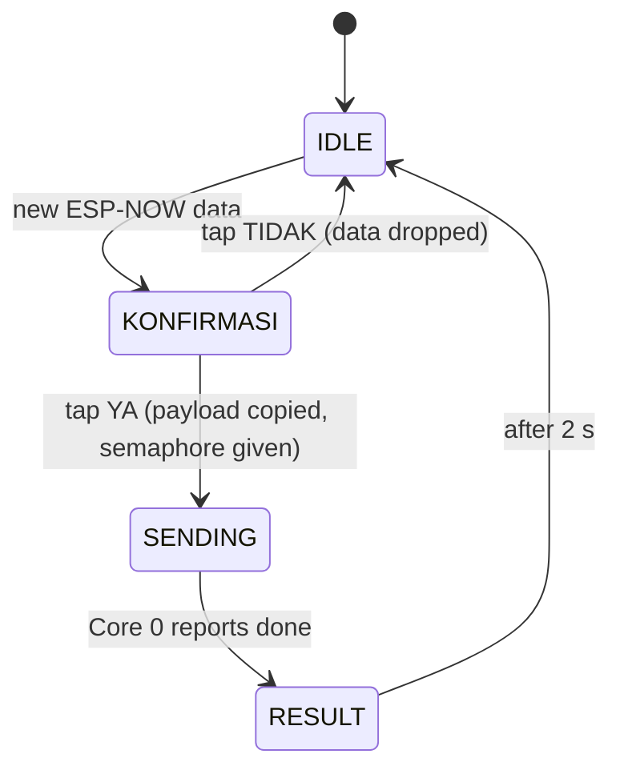

# Architecture

## System overview

The three layers follow the usual IoT health-monitoring structure: edge sensing (oximeter), cloud storage (Firestore), and an application layer (mobile app). The sensing work stays on the C3 because raw PPG is noisy and must be filtered right after capture; the cloud keeps the history because a single reading is not very meaningful without the trend.

## Oximeter unit (ESP32-C3)

Details (from `oximeter-c3/src/main.cpp` and `max30102.cpp`):

| Item | Value |
|------|-------|
| I2C | 400 kHz, SDA = GPIO8, SCL = GPIO9, address `0x57` |
| MAX30102 mode | SpO2 mode (red + IR), 100 Hz with 4x sample averaging, so about 25 Hz effective; 411 µs pulse width; ADC range 16384 nA; LED current: red `0x5F`, IR `0xAF` |
| Buffer | 100 samples (4 s at 25 Hz), recomputed every 10 new samples |
| Finger detection | raw IR must be at least 50000; more than 50 consecutive low samples resets the state |
| Algorithm | `algorithm_by_RF`: linear detrend, red/IR Pearson correlation, autocorrelation period search (HR 40-180 BPM), parabolic interpolation for sub-sample precision, SpO2 from the red/IR ratio |
| Accept conditions | HR valid, correlation ≥ 0.78, 30 < BPM < 220; SpO2 only if HR accepted and 70-100% |
| Smoothing | median of 3, then exponential smoothing with α = 0.3 |
| SpO2 status | ≥ 95 `Normal`, 90-94 `Rendah` (low), below 90 `Kritis` (critical) |
| Send interval | at least 10 s, only when data is valid and stable |
| Power saving | CPU at 80 MHz, Bluetooth stopped |
| Watchdog | I2C presence check every second; re-initializes bus, sensor, and state if it fails |

**ESP-NOW pairing:** the oximeter scans for the router SSID, locks its radio to that channel, and registers the kit box MAC as a peer. Both boards must therefore be on the router's channel.

## Kit box (ESP32-S3)
Core 1 (Arduino `loop()`) owns the display, touch, button, and battery. Core 0 runs `taskFirebase()`.

| Primitive | Purpose |
|-----------|---------|
| `xSemKirim` (binary semaphore) | One-way signal: Core 1 tells Core 0 "the user approved, send now" |
| `xMutexUID` (mutex) | Protects the shared `userID` string (written by Core 0, read by Core 1) |
| `FBPayload` snapshot | Copied before the semaphore is given, so Core 0 never reads a half-written payload |
| `fbBusy` / `fbDone` / `fbOK` flags | Core 0 reports the result back to Core 1 |

Rules: the TFT is only touched from Core 1 (SPI corruption otherwise); `taskFirebase()` ends each pass with a 10 ms delay so the WiFi stack on Core 0 gets CPU time and retries the user lookup every 5 s while `userID` is empty.

Other kit box features: NTP sync (`pool.ntp.org`, fallback `time.nist.gov`, UTC+7) with timestamps sent to Firestore as UTC; a random 4-digit Kit ID kept in EEPROM; battery estimate from an ADC divider; Serial commands `NEWID` and `STATUS`.
